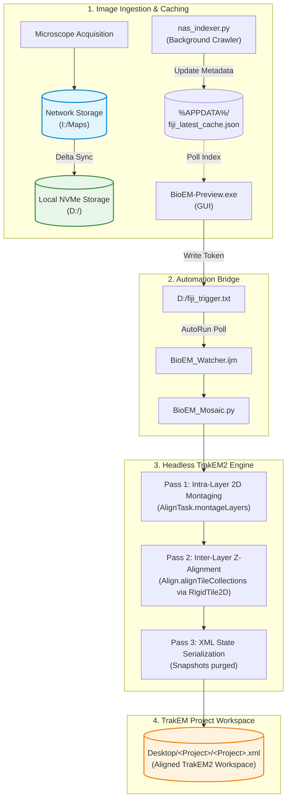

# BioEM Preview: Smart Sync & Headless Multi-Layer Alignment

An automated acquisition ingestion, synchronization, and volumetric registration framework designed for large-scale Electron Microscopy (EM) datasets, supporting Single-Tile Z-Stacks, 2D Mosaics, and Multi-Layer Mosaic Z-Stacks (work-in-progress).

## Overview
---
SBF-SEM produces large image streams across 2D spatial tiles and serial sections. With multiple possible workflows based on user's intent and project's requirements. Manually moving these datasets across the local network and configuring alignment parameters inside FIJI is time-consuming and prone to human error.

The **BioEM Preview** automates the entire transit and assembly lifecycle:

Detects and categorizes incoming acquisitions in near real-time from the network storage (NAS).
Performs "fast", delta-synchronized caching to the local high-speed NVMe storage.
Signals Fiji to execute a multi-pass hierarchical registration (intra-slice 2D stitching followed by inter-slice Z-alignment) headlessly.
Normalizes seam intensities across overlapping tiles per layer.
Generates fully configured, aligned TrakEM2 XML project workspaces ready for immediate visual review or downstream segmentation.

## System Architecture
---

---

## Core Features & Active Modules

### 1. Image Ingestion & Desktop Sync Manager (`BioEM Preview` or `pull_from_NAS.py`)

**Live Discovery:** Displays acquisitions detected within the last 14 days and or the last 21 acquisition (whichever is larger) and catalogs older sessions under a separate **All Available Data** panel.  
**Smart Delta Synchronization:** Compares file sizes and modification timestamps using (`st_mtime`) between NAS and SSD. Skips untouched frames and copies only new or updated `.tif` files.  
**Coordinate Pattern Extraction:** Parses tile grid configurations via regular expressions (`Tile_<dim1>-<dim2>-<z>`) to support real-time indexing even while an acquisition is actively running.  
**Automated Housekeeping:** Background worker prunes cached folders on `D:/` older than 30 days while protecting core directories and root system paths.  
**Fiji Process Interoperability:** Uses `psutil` to verify whether Fiji is active. If running, it alerts the open instance via a token file (`D:/fiji_trigger.txt`); if closed, it launches a fresh Fiji process with the proper working directory and bundled JRE dependencies.

### 2. Context Menu & Dataset Operations

Right-clicking any dataset entry in the UI provides:
**Refresh Folder (Wipe & Sync):** Displays a safety confirmation dialog, deletes the local dataset directory on `D:/`, and executes a fresh synchronization from the NAS source.
**Delete Existing Data:** Displays a confirmation prompt showing the target dataset name and permanently purges the local folder from `D:/`.

### 3. Headless TrakEM2 Assembly Engine (`BioEM_Mosaic.py`)
* **Two-Pass Hierarchical Registration:**
  * **1st Pass (Intra-Layer 2D Montaging):** Stitches tiles belonging to the same section (in Z) using rigid transforms (`AlignTask.montageLayers`), locking internal slice geometry.
  * **2nd Pass (Inter-Layer Z-Alignment):** Bypasses TrakEM2 modal dialogs (`GenericDialog`) by wrapping image patches into `RigidTile2D` models and invoking `Align.alignTileCollections` consecutively along the Z-axis, pinning Layer 0 as the reference anchor.

## Hardware & Software Requirements

The application and associated helper scripts were designed to accomodated MAPS project acquisitions. However, similar Apreo 2S or acquisition systems could probably recycle most of the processing steps with minimal modifications.
* **Operating System:** Windows 10/11 Pro (x64)
* **Storage:** Local NVMe SSD dedicated to caching (`D:/`) and mapped high-throughput NAS storage (`I:/`)
* **Fiji:** Fiji (ImageJ 1.54+) bundled with TrakEM2 and Python/Jython 2.7 scripting support
* **Host Python Environment:** Python 3.10+ (for building the `.exe` or running source scripts)

## Installation & Deployment

You can set up the pipeline either by downloading the pre-packaged release bundle or by compiling the standalone executable from source using PyInstaller.

### Method A: Quick Start via GitLab Release Bundle (Recommended)

Download the deployment package (`BioEM_Preview_v0.1.zip`). This can be found under the **Releases** section on this GitLab repository.
Extract the ZIP file and place the individual assets into their designated locations:

| File from ZIP | Destination Target | Description |
| :--- | :--- | :--- |
| `pull_from_NAS.exe` | `Desktop` or `C:\BioEM_Pipeline\` | The standalone GUI application |
| `nas_indexer.py` | `C:\BioEM_Pipeline\nas_indexer.py` | Headless background scanner daemon |
| `BioEM_Watcher.ijm` | `<Fiji_Path>\macros\AutoRun\BioEM_Watcher.ijm` | Polling macro (runs on Fiji startup) |
| `BioEM_Mosaic.py` | `<Fiji_Path>\macros\BioEM_Mosaic.py` | Headless TrakEM2 alignment script |

> **Note on Fiji Macro Deployment:** If the `<Fiji_Path>\macros\AutoRun\` folder does not exist, create it manually. Any `.ijm` script placed inside `AutoRun` executes automatically whenever Fiji launches.
---

### Method B: Building `pull_from_NAS.exe` from Source

If you prefer to build the binary locally or make modifications to the UI:

#### 1. Clone the Repository

```bash
git clone [https://gitlab.com/](https://gitlab.com/)<your-username-or-group>/bioem-pipeline.git C:\BioEM_Pipeline

cd C:\BioEM_Pipeline
```

#### 2. Set Up Python Environment & Dependencies

```bash
# Recommended: Python 3.10 virtual environment
python -m venv venv
.\venv\Scripts\activate

# Install required build packages
pip install customtkinter psutil pyinstaller
```

#### 3. Compile the Executable via PyInstaller

Run PyInstaller directly from the repository root, ensuring the icon asset is bundled so `sys._MEIPASS` can extract it at runtime:

```powershell
pyinstaller --noconsole `
--onefile `
--icon="app/assets/bioem_app.ico" `
--add-data "app/assets/bioem_app.ico;." `
--name "pull_from_NAS" `
app/pull_from_NAS.py
```

The compiled binary will be generated in `dist\pull_from_NAS.exe`.

#### 4. Configure Application Paths

If your workstation uses different drive letters or Fiji directories, adjust the constants near the top of `app/pull_from_NAS.py` before compiling:

```python
DESTINATION_DIR = "D:/" # Local SSD target cache

NAS_DIR = "I:/" # Mapped NAS drive

APP_PATH = r"C:\Users\User\Desktop\Fiji\fiji-windows-x64.exe" # Path to Fiji executable
```
---

## Usage Guide

### 1. Start the Background Crawler

The `nas_indexer.py` has been configured to run automatically in the background upon login on the SupportPC.

Otherwise, manually run `nas_indexer.py` in the background::

```powershell
python C:\BioEM_Pipeline\nas_indexer.py
```

This service periodically crawls `I:/Maps` and maintains `%APPDATA%\fiji_latest_cache.json`.

### 2. Launch the Application

Double-click `pull_from_NAS.exe` (or run `python app/pull_from_NAS.py`):

Find your acquisition under **Available on NAS** (or **All Available Data**).
Click the dataset button to begin the delta sync to the local SSD.
When the progress bar completes, Fiji alerts automatically:
* **Single-Tile Z-Stacks:** Opened directly as an inverted image sequence.

* **2D Mosaics & Mosaic Z-Stacks:** Dispatched to `BioEM_Mosaic.py` for headless 2D montaging, inter-layer rigid registration, and seam blending.

4. The final, aligned TrakEM2 project workspace is saved to `C:\Users\<User>\Desktop\<ProjectName>\<ProjectName>.xml`.

## Roadmap

This deployment architecture is tailored for the current Fiji/TrakEM2 processing model. Future releases will introduce the following extensions:
**GPU-Accelerated Processing Engine (`bioem_proc.py`):** Standalone headless alignment pipeline built on PyTorch and CUDA for sub-pixel Fourier phase correlation, offloading computation directly to dual NVIDIA RTX GPUs.
**OME-Zarr Streaming Integration:** Direct compilation of synchronized acquisitions into chunked, pyramidal OME-Zarr array structures on NVMe storage, bypassing RAM limits during multi-slice processing.
**Napari Interactive Volume Viewer (`view_in_napari.py`):** Immediate out-of-core inspection interface launched via a dedicated right-click action (**"Show Me the Future"**) for interactive review alongside TrakEM2 projects.
**Unified Standalone Installer:** Packaging of the Python host, GPU runtime, and viewer components into a streamlined installation wizard.

## License

This project is developed for use internally at BioEM-EPFL to facilitate imaging operations and automated pipelines. Distributed under the MIT License.